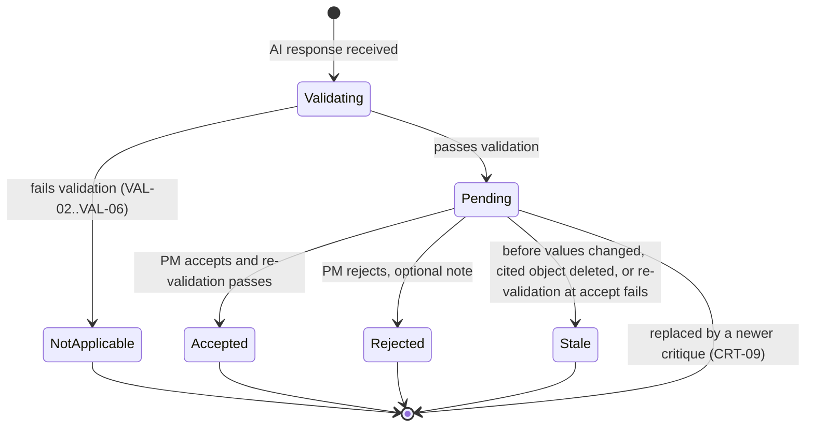

---
ddx:
  id: FEAT-004
  authoring:
    home: repo
  depends_on:
    - prd
---

# Feature Specification: FEAT-004 — AI Assistance

**Feature ID**: FEAT-004
**Priority**: P0 (FR-13 note extraction is P1)
**Owner**: Roadsmith product owner (no owner named in governing artifacts; assumption)
**Covered PRD Subsystem(s)**: AI Assistance
**Covered PRD Requirements**: FR-12, FR-13, FR-14, FR-15, FR-16, FR-17 (PRD P0-6, P1-4)
**Cross-Subsystem Rationale**: None — single subsystem. FEAT-004 reads and edits
the roadmap model owned by the other subsystems only through their validation
and edit rules.

## Overview

AI Assistance implements PRD P0-6 (FR-12, FR-14, FR-15, FR-16, FR-17) and
P1-4 (FR-13). A large language model (LLM) drafts RICE inputs, extracts backlog
items from notes, and critiques a roadmap against its dependencies, capacity,
goals, and evidence. RICE is the Reach, Impact, Confidence, Effort
prioritization framework that FEAT-002 computes. Every AI output is a proposal:
deterministic code validates it, and nothing changes the roadmap until the PM
accepts it (principle 8, "Deterministic core, AI at the edge"; experience
principle "The PM decides").

## Ideal Future State

Maya asks Roadsmith to critique the quarter's roadmap and gets findings that
can be checked in seconds. Each finding names its category, the items,
periods, or goals involved, and why it matters. Where a fix exists, the finding shows a
before-and-after diff and the plan-check result the fix would produce. Maya
accepts some fixes, rejects the rest with a note, and the plan
checks re-run at once.

AI-drafted scores and items extracted from notes arrive the same way: marked as
AI-originated, with a rationale, outside the ranking until accepted. A proposal
that would corrupt the model (a dependency cycle, an unknown item, an
out-of-range score) is never offered as applicable. When the AI service fails,
Maya sees a clear failure message and keeps planning with every non-AI
function.

## Problem Statement

- **Current situation**: PMs on small teams find dependency inversions and
  overloaded periods mid-quarter (PRD Problem; competitive analysis F22, F23).
  Incumbent AI drafts documents and summarizes feedback; none of it checks plan
  feasibility (F4, F6, F12). AI-native tools emit roadmaps as text with no
  model to check (F17, F18).
- **Pain points**: Scoring 60–120 items by hand takes most of a planning day.
  Meeting notes hold backlog items that never get typed in. AI that edits a
  plan directly, or makes claims nobody can verify, loses the PM's trust (PRD
  User Needs: "Let AI help, but don't let it change my plan behind my back").
- **Desired outcome**: A PM gets drafted scores and a grounded critique with
  validated, reviewable fixes, and reaches a roadmap with zero blocking
  violations in one sitting (PRD metric: time to first clean roadmap under 60
  minutes for a 50–100 item backlog, a hypothesis). Diff acceptance rate by
  finding category is observable (PRD learning goal).

## Functional Areas

### Terms

| Term | Definition |
|------|------------|
| AI request | One explicit PM action that sends roadmap data to the AI service: draft scores, extract items, or critique. |
| Proposal | Any AI-originated change to a roadmap. Three kinds: score draft, candidate item, remedy. A proposal is validated and applied as one unit. |
| Score draft | Proposed values for the missing RICE inputs of one item, each with a rationale. |
| Candidate item | A proposed new backlog item extracted from pasted notes. |
| Finding | One critique observation in one FR-14 category, citing items, periods, or goals. A finding has zero or one remedy. |
| Remedy | A proposal attached to a finding, shown as a before-and-after diff of the roadmap. |
| Plan-check violation | A dependency-order or capacity violation reported deterministically by FEAT-003 (FR-10). Distinct from a finding, which may come from the AI. |
| Not applicable | The state of a proposal that failed deterministic validation. It is shown with its reason and cannot be accepted. |
| Stale | The state of a pending proposal whose "before" values no longer match the roadmap, or whose cited item, period, or goal was deleted. It cannot be accepted. |

| Area | User question or job | Feature responsibility |
|------|----------------------|------------------------|
| Request boundary | What leaves my workspace, and when? | Send roadmap data only on an explicit request, within a token budget, with progress, cancel, and content-free telemetry. |
| Score drafting | Can I get first-pass RICE inputs for unscored items? | Propose missing RICE inputs with rationale, outside ranking until accepted (FR-12). |
| Note extraction | Can my meeting notes become backlog items? | Propose candidate items from pasted notes; the PM accepts or discards each (FR-13). |
| Critique | Where is this plan weak? | Return findings in the five FR-14 categories, confirmed against plan checks (FR-14). |
| Proposal review | Should I apply this fix? | Show each remedy as a diff with its predicted plan-check effect; apply on accept only (FR-15). |
| Proposal validation | Is this proposal safe to apply? | Validate every proposal deterministically; withhold failures as not applicable; detect staleness (FR-16). |
| Degraded mode | Can I keep planning when the AI fails? | Contain AI failures; keep every non-AI function usable (FR-17). |

## Task Model

| Task | Goal | Users | Needs | Rules | Realized by | Key |
|------|------|-------|-------|-------|-------------|-----|
| Draft RICE inputs for unscored items | Every unscored item has PM-accepted inputs | Sole or lead PM, team of 5–50 | "Show me which scores I'm guessing at" | — | US-009 | draft-rice-inputs |
| Turn notes into backlog items | Items buried in notes are in the backlog | Sole or lead PM, team of 5–50 | "Get my backlog in without a day of setup" | — | US-010 | extract-items-from-notes |
| Critique the roadmap and review fixes | The PM has decided every finding's remedy | Sole or lead PM; Head of Product over 2–5 PMs | "Tell me where my plan won't fit before I commit to it" | — | US-011 | critique-and-review |
| Keep planning when the AI fails | The roadmap is unchanged and editable | Sole or lead PM, team of 5–50 | "Let AI help, but don't let it change my plan behind my back" | — | US-012 | plan-without-ai |

## Requirements

### Functional Requirements by Area

#### Request boundary

REQ-01. The system must send roadmap data to the AI service only when a
workspace member with edit access explicitly starts an AI request. It must make
no background, scheduled, or on-edit AI calls.

REQ-02. An AI request must contain data from only the one roadmap being acted
on. It must not contain other roadmaps, other workspaces' data, or account data
such as member names and email addresses.

REQ-03. Each AI request control must state, before the PM starts the request,
which kinds of roadmap data the request sends.

REQ-04. When the data for a request cannot fit the per-request token budget
(set in Design), the system must not send a silently truncated roadmap. It must
tell the PM which data exceeds the limit and send nothing.

REQ-05. While a request is in flight, the system must show its progress and let
the PM cancel it. A cancelled request must add no proposals.

REQ-06. While a request is in flight, the PM must be able to view and edit the
roadmap.

REQ-07. The system must allow at most one in-flight request of each kind per
roadmap. The control for that kind must show it is running.

REQ-08. The system must record each AI request as a GenAI operation carrying
the model alias, token usage, latency, and outcome (succeeded, incomplete,
failed, cancelled). The record must contain no item text, notes, evidence
notes, or goal text. Exact signal names belong in the telemetry Contract.

#### Score drafting

DRF-01. A PM must be able to request score drafts for selected unscored items
or for all unscored items in a roadmap. An unscored item lacks at least one
RICE input. Drafts are based on item text and the roadmap's goals.

DRF-02. A score draft must propose values only for the inputs the item lacks.
A draft that proposes a value for an input the PM entered must fail validation
(VAL-05).

DRF-03. Each drafted input must show its value, an AI-drafted marker, and a
rationale that names the item text or goal it relies on.

DRF-04. A pending score draft must not affect any score, rank, auto-sequencing
result, plan check, or critique.

DRF-05. The PM must be able to accept, edit then accept, or reject each item's
score draft. Accepting stores the inputs and FEAT-002 recomputes the ranking.

DRF-06. The PM must be able to accept all pending, valid score drafts from one
request with a single explicit action.

DRF-07. An accepted drafted input must keep its AI-drafted marker until the PM
changes its value. The system must not copy the AI rationale into the input's
evidence note, so FEAT-002 flags the input as unsupported until the PM adds
evidence (FR-5).

#### Note extraction (P1)

NTE-01. A PM must be able to paste up to 20,000 characters of unstructured
notes into a roadmap and request candidate items.

NTE-02. Each candidate item must show a proposed title and may show a proposed
description and proposed links to the roadmap's existing goals, all marked
AI-proposed.

NTE-03. A candidate item must not appear in the backlog, ranking, or plan until
the PM accepts it.

NTE-04. The PM must be able to accept, edit then accept, or discard each
candidate item individually. An accepted candidate becomes a backlog item
through FEAT-001's item creation, unscored and unplaced.

NTE-05. The system must mark a candidate as a possible duplicate when its title
equals an existing item title in the roadmap, ignoring case and surrounding
whitespace.

NTE-06. The system must not save pasted notes to the roadmap. Only accepted
candidate items persist.

NTE-07. An extraction that returns no candidates must show as completed with
no items found, distinct from a failed request.

#### Critique

CRT-01. A PM must be able to request a critique of a whole roadmap, covering
its items, scores, evidence notes, dependencies, periods, capacities,
placements, and goals.

CRT-02. Every finding must carry exactly one of the five FR-14 categories:
dependency order, capacity overflow, goal coverage gap, unsupported score, or
item without a stated outcome.

CRT-03. Every finding must cite at least one item, period, or goal by name and
state a rationale.

CRT-04. A dependency-order or capacity-overflow finding from the AI must match a
plan-check violation present when the critique completes. The system must
withhold an AI finding in these categories that matches no violation.

CRT-05. A completed critique must contain one finding for every plan-check
violation present when it completes. When the AI response omits a violation,
the system must add it as a finding sourced from the plan checks, without a
remedy.

CRT-06. Each finding must show its source: AI or plan check.

CRT-07. The system must merge findings that share a category and the same set
of cited items, periods, and goals into one finding.

CRT-08. A critique with zero findings must show as completed with no findings
and list the five categories checked, distinct from a failed request.

CRT-09. When a new critique of a roadmap completes, its findings must replace
the unresolved findings of the previous critique. Recorded accept and reject
decisions must remain.

CRT-10. The system must group findings by category and show the count per
category.

#### Proposal review

REV-01. A finding with a remedy must show it as a before-and-after diff of
every roadmap value the remedy changes.

REV-02. A remedy must change only these values: an item's period placement
(including unplacing it), a RICE input, a "blocked by" dependency (add or
remove), an item-to-goal link (add or remove), and an item description.

REV-03. Each remedy diff must show the predicted plan-check result of applying
it to the current roadmap: violations it clears and violations it introduces.
The prediction must update when the roadmap changes.

REV-04. The PM must be able to accept or reject each remedy, with an optional
note of up to 500 characters.

REV-05. Accepting a remedy must apply all of its changes or none, then re-run
the plan checks and update the ranking.

REV-06. Rejecting a remedy must leave the roadmap unchanged.

REV-07. The system must record each accept or reject decision with its finding
category, proposal kind, and note, to support the acceptance-rate metric.

REV-08. No proposal of any kind must change the roadmap without the PM's
explicit accept. Leaving the review without deciding must leave proposals pending and
the roadmap unchanged.

REV-09. A pending proposal must become stale when any value it changes no
longer equals the "before" value in its diff, or when an item, period, or goal
it cites is deleted. A stale proposal must offer no accept action.

REV-10. On accept, the system must re-validate the proposal against the current
roadmap. When validation fails or the diff's "before" values no longer match,
the system must mark the proposal stale and apply nothing.

#### Proposal validation

VAL-01. The system must validate every proposal against the current roadmap
before offering it as applicable. Validation is deterministic and never asks
the AI service.

VAL-02. A proposal that would create a dependency cycle under FEAT-003's cycle
rule must fail validation.

VAL-03. A proposal that references an item, period, or goal absent from the
roadmap must fail validation.

VAL-04. A proposal that sets a RICE input outside FEAT-002's valid range must
fail validation.

VAL-05. A proposal must fail validation when it changes a value outside its
kind's allowed set (DRF-02, NTE-02, REV-02). This includes period capacity, and
creating or deleting items, periods, or goals.

VAL-06. A proposal that is incomplete or unreadable must fail validation.

VAL-07. A proposal that fails validation must be shown as not applicable with
its failure reason and no accept action. Its finding, when it has one, must
still be shown.

VAL-08. Validation must treat a proposal as one unit: if any change in it
fails, the whole proposal is not applicable.

#### Degraded mode

DEG-01. When the AI service is unreachable, returns an error, does not respond
within 60 seconds, or returns an unreadable response, the system must show a
failure message that names the failed request and offers a retry.

DEG-02. A failed AI request must leave the roadmap unchanged and add no
proposals.

DEG-03. Import, item and goal management, scoring and ranking, dependencies,
periods, placement, auto-sequencing, plan checks, period close, and account
functions must remain usable while the AI service is unavailable or not
configured.

DEG-04. Proposals pending from earlier successful requests must stay reviewable
and acceptable while the AI service is unavailable.

DEG-05. When a response is cut off or partly unreadable, the system must offer
the complete proposals and findings that pass validation, mark the result as
incomplete, and offer a re-run.

### Non-Functional Requirements

- **Performance** (targets are assumptions, unbacked by measurement; Test
  confirms them against stubbed and live runs):
  - A critique of a 100-item roadmap with 6 periods and 5 goals completes
    within 30 s at p95.
  - Score drafts for 20 items complete within 20 s at p95; for 100 items within
    60 s at p95.
  - Note extraction from 5,000 characters completes within 20 s at p95.
  - Deterministic validation of all proposals from one 100-item critique takes
    under 1 s at p95.
  - Accepting a proposal updates plan checks and ranking within 1 s at p95.
- **Cost**: A critique of a roadmap up to 150 items, 10 periods, and 10 goals
  must fit one request's token budget (assumption; Design sets the budget).
  Token usage is recorded per request (REQ-08).
- **Security and privacy**: Roadmap content leaves the workspace only on an
  explicit AI request (REQ-01, REQ-02). Telemetry carries no roadmap content
  (REQ-08). Text inside items and notes is treated as data; its worst effect is
  a proposal that fails validation or that the PM rejects.
- **Reliability**: Zero roadmap changes from failed, timed-out, cancelled, or
  incomplete requests, verified with stubbed AI faults. With the AI service
  stubbed to fail, the non-AI core flow passes end to end.
- **Usability and accessibility**: Every review action (accept, edit, reject,
  discard, cancel, retry) works by keyboard. Diffs convey before and after in
  text, not by color alone. Request completion and failure are announced to
  screen readers (WCAG 2.x AA, `a11y-wcag-aa` concern).
- **AI quality** (assumption; targets set in Test against a bounded **critique
  evaluation set** and **drafting evaluation set**, named here and built in
  Test): 100% of seeded plan-check violations appear as findings (guaranteed by
  CRT-05); at least 80% of seeded goal-coverage-gap and missing-outcome issues
  are reported; at most 10% of AI findings are judged spurious.

## User Stories

- [US-009 — Get AI-drafted RICE inputs for unscored items](../user-stories/US-009-ai-draft-rice-inputs.md)
- [US-010 — Turn meeting notes into backlog items](../user-stories/US-010-turn-notes-into-backlog-items.md)
- [US-011 — Critique the roadmap and review proposed diffs](../user-stories/US-011-critique-roadmap-and-review-diffs.md)
- [US-012 — Keep planning when the AI service fails](../user-stories/US-012-plan-without-ai.md)

## Edge Cases and Error Handling

- **Roadmap edited while a critique is in flight**: The system validates the
  returned proposals against the roadmap as it is on return. A proposal whose
  "before" values were edited since the request was sent is stale (REV-09).
- **Proposal goes stale before accept**: Accept re-validates; a mismatch marks
  it stale and applies nothing (REV-10). The PM re-runs the critique for a
  fresh remedy.
- **Accepting one remedy invalidates another**: Two remedies that move the same
  item conflict. After the first is accepted, the second is stale.
- **Finding cites an item deleted after the request**: The finding is stale and
  offers no remedy. A finding citing an item that never existed is not
  applicable (VAL-03).
- **Duplicate findings**: Merged by category and cited set (CRT-07).
- **AI claims a violation the plan checks do not report**: Withheld (CRT-04).
- **AI misses a plan-check violation**: Added from the plan checks (CRT-05).
- **Zero findings or zero candidates**: Shown as a completed result with
  nothing to review, not as a failure (CRT-08, NTE-07).
- **Partial or truncated response**: Valid complete parts are offered; the
  result is marked incomplete (DEG-05).
- **Unknown finding category**: The finding is withheld.
- **Request over budget**: Nothing is sent; the PM sees which data exceeds the
  limit (REQ-04).
- **Nothing to act on**: A critique of a roadmap with no items, or a draft
  request with no unscored items, is not sent; the control says why.
- **Two members acting at once (FR-19, P1)**: A teammate's edit makes affected
  pending proposals stale under the same rule as the PM's own edits.
- **Evidence notes not yet available (FR-5 is P1)**: Every input lacks evidence,
  so unsupported-score findings may cover most scored items.

## Success Metrics

- Diff acceptance rate by finding category (PRD learning goal), from REV-07
  decisions.
- Share of proposals withheld as not applicable, by failure reason; a rising
  share signals model or alias drift.
- Score-draft edit-before-accept rate, showing how often PMs disagree with
  drafted values.
- Share of AI requests that fail, time out, or return incomplete, from REQ-08
  telemetry.

## Constraints and Assumptions

**Operator confirmation (2026-11-10)**: the numeric limits and targets this
spec marks as assumptions are accepted as working values. Change them only
through `evolve`. Measurement in Test may still revise performance targets.

- **Constraint**: Scoring, ranking, sequencing, and plan checks work without the
  LLM; the AI layer only proposes (PRD Constraints; principle 8).
- **Constraint**: Roadmap content is customer-confidential and is sent only on
  an explicit AI request (PRD Legal/Compliance).
- **Constraint**: Models are named by alias through the model gateway
  (`model-gateway` concern). The provider is Anthropic Claude (operator,
  2026-11-10). The alias set and model versions are chosen in Design.
- **Constraint**: AI requests are traced as GenAI operations (`o11y-otel`
  concern).
- **Assumption A1**: A proposal becomes stale when a value it changes was
  edited, or an object it cites was deleted, before accept. A stale proposal
  cannot be accepted; the PM re-runs the request (REV-09, REV-10).
- **Assumption A2**: The critique confirms dependency-order and
  capacity-overflow findings against FEAT-003 plan checks and adds any
  violation the AI omits (CRT-04, CRT-05).
- **Assumption A3**: Remedies may not change capacity, period order, or create
  or delete items, periods, or goals (REV-02, VAL-05).
- **Assumption A4**: A remedy that clears one violation but introduces another
  is offered, with its predicted plan-check effect shown, not withheld (REV-03).
- **Assumption A5**: Validation is all-or-nothing per proposal (VAL-08).
- **Assumption A6**: An item's stated outcome lives in its description; a
  missing-outcome remedy edits the description.
- **Assumption A7**: An accepted AI-drafted input stays unsupported until the PM
  adds evidence (DRF-07).
- **Assumption A8**: A new critique replaces the previous critique's unresolved
  findings (CRT-09).
- **Assumption A9**: Limits of 60 s per request, 20,000 characters of notes,
  and 500-character decision notes; all NFR targets above.
- **Assumption A10**: Incomplete responses yield their valid complete parts
  (DEG-05).
- **Assumption A11**: Any workspace member with edit access may start AI
  requests and decide proposals.

## Dependencies

- **Other features**: FEAT-001 Backlog Intake (item creation for accepted
  candidates); FEAT-002 Prioritization (RICE ranges, scoring, ranking,
  unsupported-input flags); FEAT-003 Sequencing and Capacity (cycle rule,
  placement, plan-check violations); the Accounts and Workspaces feature
  (workspace membership and edit access, FR-18, FR-19).
- **External services**: Anthropic Claude, reached through the model gateway
  by alias (aliases selected in Design); OpenTelemetry collection for GenAI operations.
  Exact request, response, and telemetry surfaces live in Design Contracts.
- **PRD requirements**: P0-6 (FR-12, FR-14, FR-15, FR-16, FR-17); P1-4
  (FR-13).

## Out of Scope

- **Auto-apply**: No AI change applies without an explicit accept, including a
  bulk "apply all remedies" action. Bulk accept exists only for score drafts
  (DRF-06).
- **Chat assistant**: No free-form conversation or Q&A about the roadmap.
- **Document generation**: No PRDs, specs, release notes, or stakeholder
  summaries (PRD non-goal).
- **Feedback synthesis**: No summarizing or clustering of customer feedback;
  note extraction proposes backlog items only (PRD non-goal).
- **AI sequencing**: Auto-sequencing stays deterministic (FR-9); the AI places
  items only through remedies the PM accepts.
- **Capacity or structure changes by AI**: No AI-proposed capacity changes, new
  periods, or new goals.
- **Cross-roadmap critique**: Priya's review across three teams runs one
  critique per roadmap; no portfolio-level critique.
- **Scheduled or continuous critique**: Critique runs only on request.
- **Undo history**: Accepted changes become ordinary roadmap edits the PM can
  change by hand; no multi-step undo.
- **Model, alias, and prompt choices**: Owned by Design. The provider (Anthropic Claude) was chosen by the operator on 2026-11-10.
